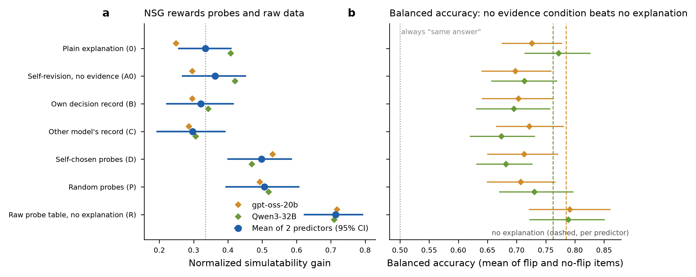
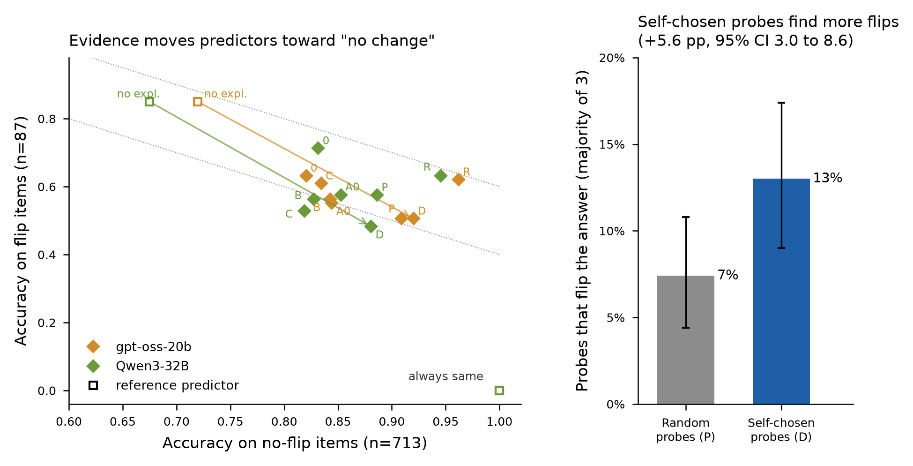

# Does in-context self-study make LLM self-explanations more faithful?

A $5 pilot on the NSG faithfulness benchmark, and the base-rate effect that drives NSG gains.

## TL;DR

I tested whether a frozen LLM (Gemma-3-27B) writes more *faithful* self-explanations after observing its own behaviour in context: a record of its past decisions, or experiments it designs and runs on itself. Faithfulness was measured with **Normalized Simulatability Gain (NSG)** on the benchmark of Mayne et al. (ICML 2026), using two predictor models (gpt-oss-20b, Qwen3-32B), 100 explained cases and 800 counterfactual test cases.

- **Baseline reproduces the paper.** Plain self-explanation NSG is 34.5% [24.9, 43.9], against 34.92% published.
- **Self-experimentation raises NSG** by +16.4 points [7.4, 24.7] …
- **…but random experiments do equally well** (−0.9 [−11.2, 9.3]), and handing the predictor the raw experiment results with no explanation beats every explanation (NSG 71.4%).
- **The gain is mostly a base-rate effect.** Gemma keeps its answer on 89% of test cases (the true label changes on ~50% of the same real pairs). Evidence teaches predictors that Gemma rarely changes its mind, so they get better on unchanged cases and *worse* on the cases that actually change. **On balanced accuracy, no evidence condition beats giving no explanation at all.**
- **The model does choose informative experiments:** self-chosen probes change its answer 13.0% of the time, against 7.4% for random probes. That self-knowledge does not reach its written explanations.

Mayne et al. already report one side of this (explanations reduce predictors' "false-change bias"). The missed-change side, the balanced-accuracy null result and the random-probe control were not found in prior work. See [docs/pilot_report.md](docs/pilot_report.md).




## What's in this repo

| Path | Contents |
|---|---|
| [docs/pilot_report.md](docs/pilot_report.md) | Full results, statistics, caveats and cost |
| [docs/pilot_workflow.md](docs/pilot_workflow.md) | Exactly what each model received and produced at each stage, and how every score is computed |
| [docs/worked_example.md](docs/worked_example.md) | One case followed through every condition, with real model outputs |
| [docs/proposal_evaluation.md](docs/proposal_evaluation.md) | Critique of the original research proposal (fact-checked citations, design risks) |
| [docs/gap_map_behavior_consistency.md](docs/gap_map_behavior_consistency.md) | Source-linked literature map for the follow-up idea (behaviour-side self-consistency) |
| `selfexp/` | Pipeline: item construction, async OpenRouter client with caching and cost caps, conditions, predictors, analysis |
| `data/` | Explained cases, test sets, records, all condition texts, all 12,800 predictor outputs |
| `results/` | NSG, balanced-accuracy, targeting and cost tables; figures; literature screening table |

## Conditions

| ID | What the target sees before rewriting its explanation |
|---|---|
| 0 | Nothing extra (Mayne's plain protocol) |
| A0 | A reflection prompt, no new evidence (format-matched control) |
| B | Its own answers on 20 similar cases |
| C | The same 20 cases, with another model's answers presented as its own |
| D | Results of 5 single-feature experiments it chose itself, each run 3 times |
| P | The same, but 5 random experiments |
| R | (no explanation) the predictor sees D's raw results directly |

## Reproducing

```bash
git clone https://github.com/HarryMayne/faithfulness.git mayne   # benchmark data + prompt templates (CC BY 4.0)
pip install -r requirements.txt
export OPENROUTER_API_KEY=...
python selfexp/build_items.py                          # writes data_pilot/
python selfexp/run_pilot.py --key-env OPENROUTER_API_KEY --conc 48
python selfexp/analysis_full.py
```

- The full run makes about 23k API calls and cost **$4.81** on OpenRouter (target: Gemma-3-27B-it via a single bf16 provider). A hard spend cap is built in.
- `data/` contains the condition texts and predictor outputs from the original run. The target's raw per-sample test answers (the labels) were not preserved, so re-scoring requires rerunning the pipeline.

## Limitations

One target model, five tabular domains, 100 cases; 51% of test cases are synthetic single- or double-feature edits, some internally inconsistent; the planned leakage audit was not run. See the "Caveats" section of the report.

## Next step

The pilot held the target's behaviour fixed and only changed its explanation. The follow-up question is the behaviour side: does in-context self-study make the model *decide* more consistently with its own stated criteria? The literature map is in `docs/gap_map_behavior_consistency.md`.

## Acknowledgements and citations

- Benchmark, prompt templates and parsing logic: Mayne, Kang, Gould, Ramchandran, Mahdi & Siegel (2026), *A Positive Case for Faithfulness: LLM Self-Explanations Help Predict Model Behavior*, ICML 2026, [arXiv:2602.02639](https://arxiv.org/abs/2602.02639); code at github.com/HarryMayne/faithfulness (CC BY 4.0). `selfexp/prompts.py` adapts their answer-parsing functions.
- Pres, Ruis, Ghebreselassie, Li & Andreas (2026), *Self-CTRL: Self-Consistency Training with Reinforcement Learning*, [arXiv:2606.18327](https://arxiv.org/abs/2606.18327).
