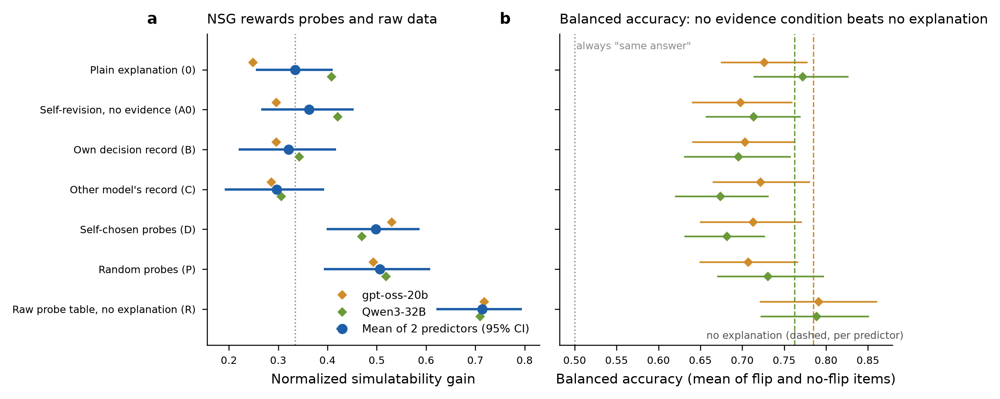
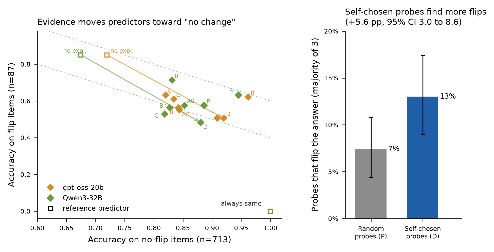

# Pilot report: in-context self-experimentation and NSG faithfulness

*Pilot run 2026-10-31. 100 explained items. Target Gemma-3-27B-it. Predictors gpt-oss-20b and Qwen3-32B. Total cost $4.81.*

## TL;DR

1. **Baseline reproduction passes.** The plain self-explanation NSG on Mayne-comparable items is 34.5% [24.9, 43.9], averaged over two predictors. Mayne et al. publish 34.92% for the same target model.
2. **Self-experimentation raises NSG.** Letting the model choose and run 5 single-feature probes on itself (D) raises NSG from 33.4% to 49.8% (+16.4 points [7.4, 24.7]). Against a format-matched rewrite with no evidence (A0), the gain is +13.5 [4.9, 21.5].
3. **The gain is not self-specific and not explanatory.**
   - Random probes (P) do as well as self-chosen ones: D − P = −0.9 [−11.2, 9.3].
   - Handing the predictor the raw probe table with no explanation (R) does far better than any explanation: NSG 71.4%, and D − R = −21.6 [−30.0, −13.8].
   - The model's own decision record (B) is indistinguishable from another model's record (C): B − C = +2.4 [−4.7, 9.7].
4. **Most of the NSG gain is a base-rate effect.**
   - Gemma keeps its reference answer on 89.1% of test items. Evidence teaches the predictor to say "no change" more often: from 77% of predictions (condition 0) to 84–87% (D).
   - On the 87 test items where the answer does flip, D makes predictors *worse* (gpt-oss 0.632 → 0.506; Qwen 0.713 → 0.483).
   - In balanced accuracy (the mean of flip and no-flip accuracy), no evidence condition beats giving no explanation. For Qwen3-32B, D is significantly worse than the plain explanation (−9.0 pp [−14.4, −4.3]).
5. **One positive mechanism result.** Probes the model chooses for itself flip its answer 13.0% of the time, against 7.4% for random probes (+5.6 pp [3.0, 8.6]). The model picks influential features at about 1.75× chance. That knowledge does not survive into its written explanation.

**Recommendation.** Do not scale up the current design. The pilot's main finding is methodological: NSG on this benchmark, for a low-sensitivity model, rewards a "no change" prior. That is a more interesting and more defensible post than "self-experimentation helps". Section 6 gives the redesign and a budget.

*Figure 1. (a) NSG by condition: mean of two predictors with 95% paired item-level bootstrap CI, plus per-predictor points. The dotted line is condition 0. (b) Balanced accuracy, the mean of accuracy on flip items (n=87) and no-flip items (n=713), with 95% CIs. Dashed lines are each predictor without any explanation; the dotted line at 0.5 is the trivial "always same answer" predictor. n = 100 explained items × 8 test items.*

## 1. What was run

| Component | Pilot setting |
|---|---|
| Benchmark | Mayne et al. tabular datasets: heart disease, Pima diabetes, breast-cancer recurrence, adult income, IBM attrition. Bank marketing was dropped because its released descriptions cannot be regenerated exactly. |
| Explained items | 100 (20 per dataset, fixed seed), sampled from Mayne's `combined_dataset.parquet` |
| Test items per item | 8: 4 at Hamming distance 1 and 4 at distance 2. 303 are Mayne's real counterfactuals; 497 are synthetic edits using observed feature values. All 100 item and 303 real descriptions match Mayne's text exactly. |
| Target | `google/gemma-3-27b-it`, bf16, pinned to one provider (Novita); T=1.0, top-p 0.95, top-k 64 (Mayne's config) |
| Target labels | Modal answer of 5 samples per test item. On real items, on average 97.4% of the 5 samples matched the majority answer. Separately, all 3 samples agreed on 92.8% of the 1,000 probes. |
| Predictors | `openai/gpt-oss-20b` (reasoning medium) and `qwen/qwen3-32b` (thinking on), using Mayne's predictor prompt templates verbatim |
| Mismatched-record model | `qwen/qwen3-30b-a3b-instruct-2507` (condition C) |
| Data and code | [items.parquet](../data/items.parquet), [testsets.parquet](../data/testsets.parquet), [records.parquet](../data/records.parquet); [conditions.parquet](../data/conditions.parquet); [predictions.parquet](../data/predictions.parquet); [selfexp_code.tar.gz](../selfexp/) |

**Conditions.** All conditions use the same answer on x (fixed predictor input). No explainer changed its answer in any condition (0/700).

| ID | What the explainer sees before (re-)explaining | Mean words |
|---|---|---|
| 0 | Mayne's plain prompt (answer + explanation in one turn) | 293 |
| A0 | Follow-up turn: "reflect on what drove your decision", then rewrite (≤250 words). No new evidence. *Added after the smoke test showed rewrites are shorter than condition-0 explanations; this is the format-matched control.* | 172 |
| B | Its own answers on the 20 nearest real rows (each from a fresh session), then rewrite | 145 |
| C | The same 20 rows, but with the other model's answers presented as its own. The records agree 80.5% of the time, so for some items C's prompt equals B's. | 147 |
| D | The model picks 5 single-feature edits from a menu (exact test items excluded), each is run 3× on itself, and it sees the results, then rewrites. It produced 5 valid picks on 100/100 items. | 162 |
| P | As D, but 5 random features | 161 |
| R | The predictor gets D's raw probe table instead of an explanation | 108 |

Example inputs to the predictor for each condition: [pilot_transcripts.md](../docs/pilot_transcripts.md).

## 2. Baseline sanity check

| | Acc. without expl. | Acc. with expl. | NSG [95% CI] |
|---|---|---|---|
| Mean of 2 predictors | 0.660 | 0.777 | **34.5%** [24.9, 43.9] |
| gpt-oss-20b | 0.690 | 0.772 | 26.6% [14.1, 38.2] |
| Qwen3-32B | 0.630 | 0.782 | 41.1% [29.0, 52.9] |
| *Mayne et al., Gemma-3-27B, 5 predictors, 7 datasets* | *71.01* | *81.14* | *34.92% [32.58, 37.40]* |

These are Mayne-comparable items: the 303 real counterfactuals, scored against the first sample, in condition 0 ([nsg_mayne_comparable.csv](../results/nsg_mayne_comparable.csv)). The pipeline reproduces the published effect.

**Ground-truth shortcut check** (Section 3 of the evaluation; arXiv 2609.08585). On real items, the ground-truth label predicts Gemma's answer only 48.5% of the time; Gemma answers YES/RECURRENCE on 86/100 explained items. The no-explanation predictors match the model (68.3%, 62.4%) better than the ground truth (59.7%, 60.4%). The label-prior shortcut is not what drives these results ([shortcut_check.csv](../results/shortcut_check.csv)).

## 3. Main results (NSG)

NSG is the mean of the two predictors, with a paired bootstrap over explained items (2,000 resamples) ([nsg_main.csv](../results/nsg_main.csv), [contrasts_power.csv](../results/contrasts_power.csv)).

| Condition | NSG | Δ vs 0 [95% CI] |
|---|---|---|
| 0 plain | 33.4% | — |
| A0 rewrite, no evidence | 36.2% | +2.8 [−4.9, 10.5] |
| B own record | 32.1% | −1.3 [−10.0, 6.8] |
| C other model's record | 29.7% | −3.7 [−13.0, 5.0] |
| D self-chosen probes | 49.8% | **+16.4** [7.4, 24.7] |
| P random probes | 50.7% | +17.2 [7.0, 26.9] |
| R raw probe table | 71.4% | +38.0 [28.8, 46.4] |

| Key contrast | Δ NSG [95% CI] | Reading |
|---|---|---|
| D − A0 | +13.5 [4.9, 21.5] | Evidence matters, not the rewrite format |
| D − P | −0.9 [−11.2, 9.3] | Self-chosen probes give no NSG advantage over random ones (H3 not supported) |
| D − R | −21.6 [−30.0, −13.8] | The explanation loses information relative to the raw data ("compression" fails) |
| B − C | +2.4 [−4.7, 9.7] | No self-specific record effect, consistent with Blandfort & Pawar |
| B − A0 | −4.1 [−11.6, 3.7] | A passive record gives nothing (H2 not supported) |

The two predictors disagree on size. D − 0 is +28.2 [18.0, 38.2] for gpt-oss-20b but only +6.1 [−3.5, 15.2] for Qwen3-32B.

**Unprobed test items** (no changed feature was probed by D; n=283; [nsg_unprobed_by_D.csv](../results/nsg_unprobed_by_D.csv)). D − 0 is +9.0 [−3.5, 21.6], P − 0 is +15.8 [1.9, 29.5] and R − 0 is +18.8 [7.3, 31.6]. Even on items D never touched, random probes and raw data do at least as well. This is the first sign that the gain is not knowledge about specific features. Per-cell results are in [nsg_cells_by_D.csv](../results/nsg_cells_by_D.csv).

## 4. Why NSG rises: the "no change" prior

*Figure 2. (a) Each point is one condition × predictor. The x-axis is accuracy on test items where Gemma keeps its reference answer (n=713); the y-axis is accuracy where it changes (n=87). Open squares are reference predictors: no explanation, and the trivial "always same". Arrows run from no explanation to D. Dotted lines are iso-balanced-accuracy at 0.70 and 0.80. (b) Share of probes whose majority answer (of 3) differs from the reference answer, with item-level bootstrap 95% CIs; n = 100 items × 5 probes.*

Gemma-3-27B rarely changes its answer. The flip rate is 10.9% of test items overall, 11.9% on Mayne's real counterfactuals, and 0/160 on heart disease. The no-explanation predictor expects changes to matter: it predicts "same" only 62–66% of the time. Any evidence showing the model is stubborn moves the predictor along the trade-off line in Fig. 2a:

| Predictor | Condition | Says "same" | Acc. flip items | Acc. no-flip items | Balanced acc. | Δ balanced vs 0 [95% CI] |
|---|---|---|---|---|---|---|
| gpt-oss-20b | no explanation | 0.658 | 0.851 | 0.719 | 0.785 | +5.9 [1.8, 10.1] |
| | 0 plain | 0.771 | 0.632 | 0.820 | 0.726 | — |
| | D self-probes | 0.874 | 0.506 | 0.920 | 0.713 | −1.3 [−8.0, 4.9] |
| | R raw table | 0.899 | 0.621 | 0.962 | 0.791 | +6.5 [−0.9, 12.9] |
| | always same | 1.000 | 0.000 | 1.000 | 0.500 | — |
| Qwen3-32B | no explanation | 0.618 | 0.851 | 0.675 | 0.763 | −1.0 [−5.6, 5.2] |
| | 0 plain | 0.772 | 0.713 | 0.832 | 0.772 | — |
| | D self-probes | 0.841 | 0.483 | 0.881 | 0.682 | **−9.0** [−14.4, −4.3] |
| | R raw table | 0.882 | 0.632 | 0.945 | 0.789 | +1.7 [−5.3, 8.3] |

Full table: [flip_stay_balanced.csv](../results/flip_stay_balanced.csv).

This also qualifies the reproduced baseline. On real items only, the plain explanation changes balanced accuracy by −2.4 pp for gpt-oss and +3.8 pp for Qwen relative to no explanation. For this target model, the 34.5% NSG is mostly carried by the no-flip items.

**How this relates to prior work.** Mayne et al. (App. A.3.1, Table 4) already report one side of this mechanism. Without an explanation, predictors predict a change where the reference model gave the same answer (false-change bias: 35.4% for gpt-oss-20b, 38.8% for Qwen3-32B), and explanations roughly halve this. They interpret it as explanations correcting predictor errors. Self-CTRL (App. J) notes a related quirk: when behaviour becomes generally more predictable, NSG credits the no-explanation baseline rather than the explanation. Not found in Mayne et al. or in our literature searches:
- (a) the other side of the trade-off, where predictors miss more real changes;
- (b) balanced accuracy showing no net gain;
- (c) random probes and raw tables producing the same shift, so the "correction" can happen without feature-specific information.

**Gemma under-reacts relative to real outcomes.** On the same 303 real Mayne counterfactual pairs, the ground-truth label changes in 49.8% of pairs (Mayne's counterfactual sets are built to be roughly balanced), while Gemma's answer changes in 11.9%. Gemma answers YES/RECURRENCE on 86 of 100 originals, and its accuracy against ground truth on real items is 48.5%. Some real-world label changes are noise that no model should track, so 49.8% is not a target. But the gap points to insensitivity, or anchoring on a default answer, rather than a well-calibrated policy.

**Targeting (H3, mechanism part).** Self-chosen probes flip the answer on 13.0% [9.0, 17.4] of probes; random probes on 7.4% [4.4, 10.8], a difference of +5.6 pp [3.0, 8.6] ([probe_targeting_summary.csv](../results/probe_targeting_summary.csv)). The model does have some usable sense of which of its features matter. But the explanations written from these probes are no better for predicting flips than those written from random probes.

## 5. Hypotheses: pilot verdicts

| Hypothesis | Pilot verdict |
|---|---|
| H1 restyling does not raise NSG | Supported: A0 − 0 = +2.8 [−4.9, 10.5] |
| H2 a passive record helps | Not supported: B − A0 = −4.1 [−11.6, 3.7] |
| H3 active probes beat a passive record, and beat random probes | Half: D beats B (+17.7 [8.9, 26.7]) but not P (−0.9). Probe *choice* is better than random (+5.6 pp flips), but this does not reach the explanation. |
| H4 closing the training gap | Not tested (dropped as not like-for-like) |
| New: NSG gains reflect predictor base-rate shifts | Supported for this target: no evidence condition improves balanced accuracy |

## 6. Go/no-go and redesign for the full run

**No-go for scaling the current design.** A larger N would shrink CIs around an effect that is mostly a base-rate artefact. The power table shows D − A0 would need only about 76 items at the observed effect, so N is not the bottleneck; the metric is.

Changes before any full run:

1. **Primary metric.** Use balanced accuracy, or NSG computed separately on flip and no-flip strata, and always show the "always same" and "no explanation" predictors. Keep plain NSG as the Mayne-comparable secondary metric.
2. **Flip-enriched test sets.** Use the target's sampled labels to build test sets with about 50% flip items. Gemma's 11% flip rate means the pilot has only 87 flip items; screen candidate edits cheaply (≈$0.0001 per target call).
3. **A more sensitive target.** Screen 2–3 Mayne-evaluated models (for example Qwen3-14B and Gemma-3-12B on a working provider) for flip rate on 50 items before committing. The screen costs under $1.
4. **Keep R, and add D+R** (explanation plus raw table) as the practical "investigate-then-report" method. Also add an explicit "the model rarely changes its answer" base-rate sentence as a control, to measure the prior effect directly.
5. **Drop B/C sweeps**, which show no effect. Keep C as a one-cell control.

**Budget estimate.** About $0.048 per explained item at pilot settings ($4.81 / 100 items, including the smoke tests and billed failures; two predictors, 7 conditions, 8 tests). A 300-item flip-enriched run with 6 conditions is about $12–15, plus about $1 for the target screen.

## 7. Caveats

- One target model and five tabular domains. The base-rate finding may be weaker for more sensitive models; that is what the redesign tests.
- 51% of test items are synthetic single- or double-feature edits. Flip rates are similar on real and synthetic items (11.9% vs 10.3%).
- Gemma-3-12B, the originally planned target, was abandoned because its bf16 OpenRouter endpoint returned empty content in about 80% of calls. Qwen3-8B is no longer on OpenRouter.
- Qwen3-32B predictor calls were routed across fp8 providers (DeepInfra, SiliconFlow) after its pinned endpoint degraded. The provider is logged per call.
- The predictor setup follows Mayne's: answer-last prompt, single sample, parsed `[ANSWER]`. Of 12,800 predictions, 1 was unparseable.

## 8. Cost

| Model | Calls | Cost (ledger) |
|---|---|---|
| qwen/qwen3-32b (predictor) | 6,454 | $2.14 |
| google/gemma-3-27b-it (target) | 8,230 | $1.16 |
| openai/gpt-oss-20b (predictor) | 6,454 | $0.44 |
| qwen/qwen3-30b-a3b-instruct (record C) | 1,634 | $0.30 |
| google/gemma-3-12b-it (abandoned smoke test) | 447 | $0.05 |
| **OpenRouter account total** (includes billed-but-empty calls) | | **$4.81** |

Source: [cost_ledger_by_model.csv](../results/cost_ledger_by_model.csv).
